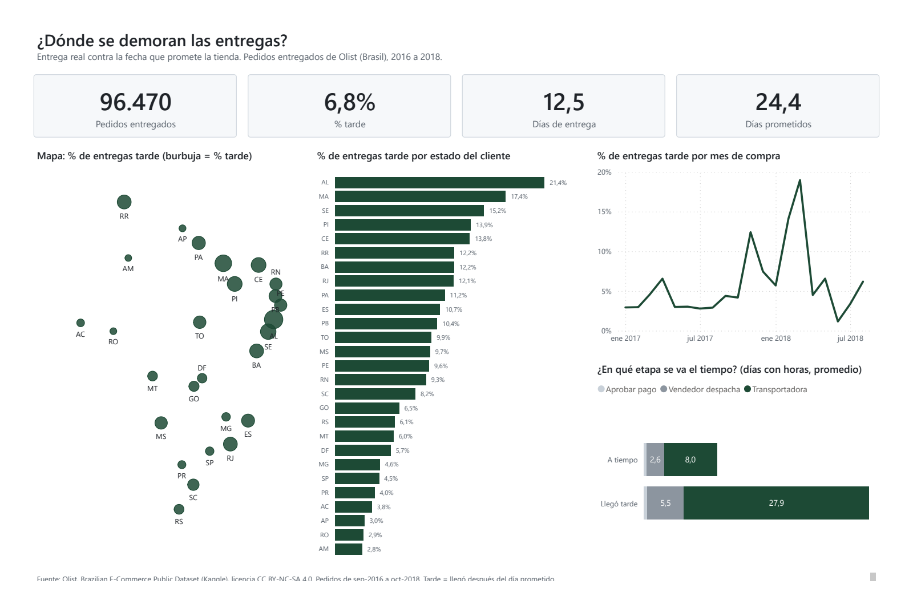
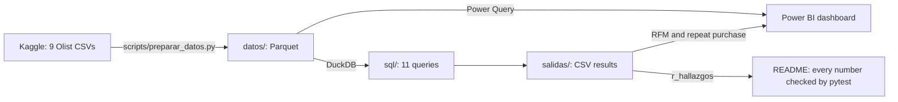

# Olist: where do deliveries get delayed?

[Versión en español](README.md) · 

I analyzed 99,441 real orders from Olist, a Brazilian online marketplace, to answer three logistics questions: where deliveries get delayed, how much shipping weighs on the price, and which sellers deliver on time. I used SQL (DuckDB) and a 4-page Power BI dashboard.

> **In 30 seconds:** 6.8% of deliveries arrive late, but in 72.2% of those cases the seller shipped on time: the problem is transport. And being late is expensive: the review score drops from 4.29 to 1.73 within a week of delay. And almost nobody buys again: 2.2%.



## What I found

**1. The store promises with a big buffer, and it still misses.**
On average it promises 24.4 days and delivers in 12.5. Even so, 6,534 of the 96,470 delivered orders arrived late: 6.8%. Rio de Janeiro gets 12.8% of the deliveries but 22.9% of the delays.

**2. When an order is late, it is rarely the seller's fault.**
In 72.2% of the late orders, the seller handed the package to the carrier on time (counting single-seller orders, which are almost all of them). The time is lost in transport: 27.9 days for late orders against 8.0 for on-time ones. And it is not a handful of bad sellers: the 5% of sellers with the most delays have 58.7% of the delays, but also 49.9% of the orders. Delays follow volume.

**3. The review score drops in the first week, and after that it no longer matters how late.**
On time, the average score is 4.29 out of 5. Between 1 and 6 days late, each day costs 0.38 points. From day 7 on it stops falling and stays at 1.73. And I found out why: 99.7% of those reviews were written before the package arrived. The customer rates the wait, not the product, so what hurts is missing the date, not by how much.

**4. On cheap orders, shipping is almost half the price.**
Across Olist, shipping is 16.6% of the product price. But on orders under R$50, which are 29.8% of all orders, shipping is 48.4%. In 10.2% of those orders shipping costs more than what was bought.

**5. Almost nobody comes back, and I could not prove the delay is the cause.**
Only 2.2% of customers bought on more than one day. At first I found that customers whose first order arrived late come back much less, but then I noticed they bought closer to the end of the data and had less time to return. Giving everyone the same 180-day window, 2.02% came back if it arrived on time and 1.61% if it was late. The z-test gives 1.71, below 1.96: the difference may be chance. What does matter is something else: 22.7% of customers made a single high-value purchase (top 40% by spend) and never returned, and that group left 41.1% of the money.

**What I would test with this:** review the São Paulo → Rio de Janeiro route with the carrier before looking at sellers, warn the customer as soon as an order is going to be late (the score drops from day one), and look for ways to group shipments under R$50.

## How to explain it in 2 minutes

> I wanted to practice SQL with real logistics data, so I took the almost 100 thousand public orders from Olist, an online marketplace in Brazil, and asked three questions: where deliveries get delayed, how much shipping weighs, and which sellers deliver on time.
>
> The first thing I saw is that the store promises almost double the time it actually takes: it promises 24 days and delivers in twelve and a half. Still, one in fifteen orders arrives late, and Rio de Janeiro takes almost a quarter of those delays.
>
> What surprised me most is that the problem is not the sellers. In seven out of ten late orders, the seller shipped on time and the time was lost with the carrier. And the sellers with the most delays are mostly the ones that sell the most.
>
> Then I crossed deliveries with reviews. One day late already lowers the score, and after a week it hits the floor: from 4.3 it goes to 1.7 and stays there. I also thought customers whose first order arrived late come back less, but once I gave everyone the same time to return, the difference was no longer strong enough to claim. I would rather say that than tell something the data does not support.
>
> Everything is in numbered SQL queries, with automated tests that check every number in the README comes from the data. The Power BI dashboard has four pages: logistics, sellers, customers and reviews.

## The dashboard

| Page | What it answers |
|---|---|
| Logística (Logistics) | Where and when orders arrive late, and which stage takes the time |
| Vendedores (Sellers) | Whether the seller shipped on time, who piles up delays and on which routes |
| Clientes (Customers) | RFM segments, repeat purchases and shipping by order value |
| Reseñas (Reviews) | How much the score drops with each day of delay |

The dashboard labels are in Spanish. Screenshots: [sellers](capturas/02_vendedores.png), [customers](capturas/03_clientes.png), [reviews](capturas/04_resenas.png). Full dashboard as PDF: [tablero.pdf](tablero.pdf). DAX measures: [dax/medidas.md](dax/medidas.md).

## Where the data comes from

- **Source:** [Brazilian E-Commerce Public Dataset by Olist](https://www.kaggle.com/datasets/olistbr/brazilian-ecommerce), published by Olist on Kaggle. Real data from 2016 to 2018, already anonymized by Olist: 9 CSV files with orders, customers, sellers, products, payments, reviews and zip codes.
- **License:** [CC BY-NC-SA 4.0](https://creativecommons.org/licenses/by-nc-sa/4.0/). It can be shared and adapted for non-commercial use, crediting Olist and under the same license. That is why the copy in `datos/` and the results in `salidas/` are also CC BY-NC-SA 4.0, attributed to Olist.
- **What I changed:** I converted the CSVs to Parquet (126 MB down to 22 MB, same rows). I removed the review comment text, because the analysis does not use it and it is text written by people. And I reduced geolocation to one point per zip code. `scripts/preparar_datos.py` does all of this from the Kaggle CSVs.
- **How I count "late":** the order arrived after the promised day, comparing calendar days. Arriving on the promised day counts as on time. Note: Olist stores the promised date at 00:00, so if you compare timestamps, everything delivered on that same day shows up as late and the rate goes up to 8.1%. That is why other Olist analyses report that number.

## How it fits together



| Question | Query |
|---|---|
| Does it arrive when promised? In which states does it fail? | `sql/02_entrega_por_estado.sql` |
| Which sellers deliver? Are delays concentrated? | `sql/03_entrega_por_vendedor.sql` |
| How much does shipping weigh against price? | `sql/04_flete.sql` |
| How much does the score drop per day of delay? | `sql/05_demora_vs_resena.sql` |
| Do customers come back? Does the first delivery matter? | `sql/06_cohortes_recompra.sql` |
| Who buys often and how much (RFM)? | `sql/07_rfm.sql` |
| Which stage takes the time? Which routes fail? | `sql/08_rutas_y_etapas.sql` |
| When did delays spike? | `sql/09_mes_a_mes.sql` |

## What is in the repo

| Folder | Contents |
|---|---|
| `sql/` | 11 numbered, commented queries: clean base, data quality, deliveries by state and by seller, shipping, delay vs review, repeat-purchase cohorts, RFM, routes and stages, month by month, and the README numbers |
| `salidas/` | The result of each query as CSV |
| `pruebas/` | pytest tests: Kaggle totals, queries that reconcile with each other, README numbers that match the data, dashboard fields and measures that exist, and privacy |
| `powerbi/` | The dashboard as a text project (PBIP), the `.pbix` and its generator |
| `dax/medidas.md` | The DAX measures |
| `capturas/`, `tablero.pdf` | Screenshots and PDF of the dashboard |
| `REVISION.md` | The review rounds, with what I found and fixed (in Spanish) |

SQL used: CTEs, window functions (`RANK`, `NTILE`, `LAG`, `ROW_NUMBER`, running totals, moving average), `QUALIFY`, `FILTER`, cohorts by first-purchase month and linear regression with `REGR_SLOPE`.

## How to run it

You need Python 3.12 and Git.

```bash
git clone https://github.com/Dsergio909/olist-logistica-sql.git
cd olist-logistica-sql
python -m venv .venv
.venv\Scripts\activate          # on Windows. On Mac or Linux: source .venv/bin/activate
pip install -r requirements.txt
python scripts/correr_sql.py     # runs the 11 queries and writes salidas/
python -m pytest                 # the tests
```

No Kaggle download needed: the data is already in `datos/`. To rebuild it from the original CSVs:

```bash
pip install kagglehub
python scripts/descargar_datos.py   # downloads the 9 CSVs to datos_crudos/ and counts rows
python scripts/preparar_datos.py    # converts them to Parquet in datos/
```

The dataset is public and downloads without an account. If Kaggle ever asks for credentials, the script explains how to create the token (that file never goes into the repo).

**Power BI:** open `powerbi/OlistLogistica.pbix` (data included). For the text project, open `powerbi/OlistLogistica.pbip`, go to Transform data → Parameters, set `CarpetaRepo` to the folder where you cloned the repo and click Refresh.

## How I checked the numbers

- **58 pytest tests**, run automatically on GitHub Actions: Kaggle totals, queries that reconcile with each other, `salidas/` matching what the SQL produces, privacy, and the README quoting exactly the numbers in `salidas/r_hallazgos.csv` (if I edit a number by hand, the test fails).
- **A second route:** `scripts/auditoria_independiente.py` recomputes 19 numbers with plain Python from the Kaggle CSVs, without DuckDB. They match.
- **Dashboard vs SQL:** `scripts/comparar_tablero.py` reads the Power BI PDF and compares 88 numbers with `salidas/`. They match.
- Everything I reviewed and fixed is in [REVISION.md](REVISION.md) (in Spanish).

## Limits

- The data ends in August 2018. September and October 2018 have almost no orders, so the time series go from January 2017 to August 2018.
- I do not know which carrier handled each order: Olist does not publish it. That is why I talk about "the transport stage" and not a company.
- Repeat purchases are so rare that this data cannot tell whether delays affect them. More years of orders, or data on why customers do not return, would measure it better.

## How I built it

The code and the first analysis were done by Claude (AI) together with me. I defined the questions, reviewed the numbers and decided what to tell. The automated tests are there so none of this depends on taking my word for it.

## License

- Code (SQL, Python and the dashboard generator): [MIT](LICENSE).
- Data in `datos/` and results in `salidas/`: [CC BY-NC-SA 4.0](https://creativecommons.org/licenses/by-nc-sa/4.0/), attribution: Olist, *Brazilian E-Commerce Public Dataset by Olist* (Kaggle). Each folder has its own notice: [datos/LICENSE.md](datos/LICENSE.md) and [salidas/LICENSE.md](salidas/LICENSE.md).
