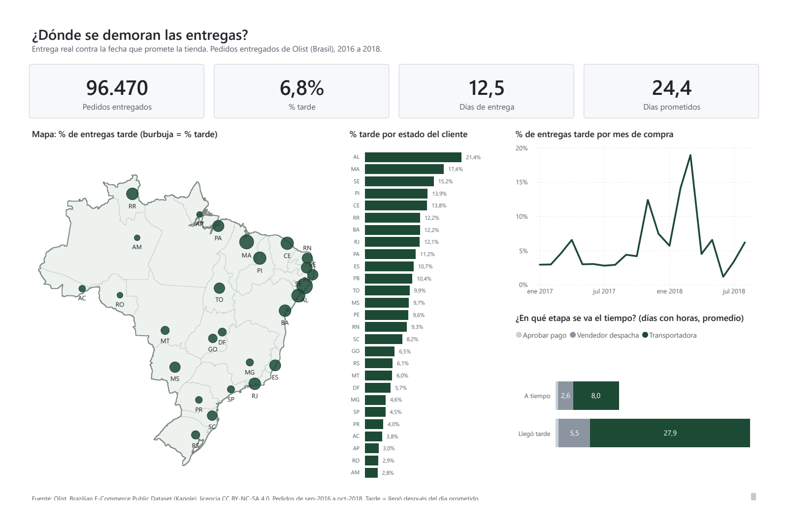
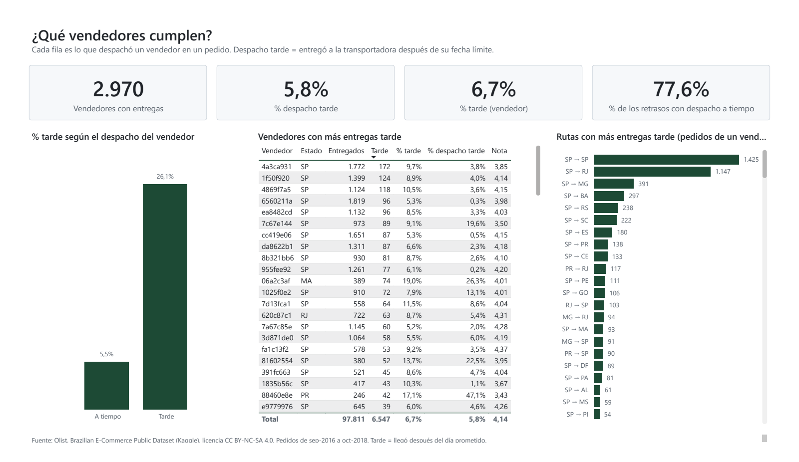
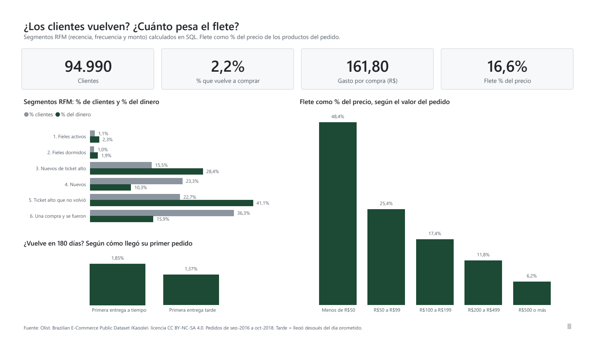
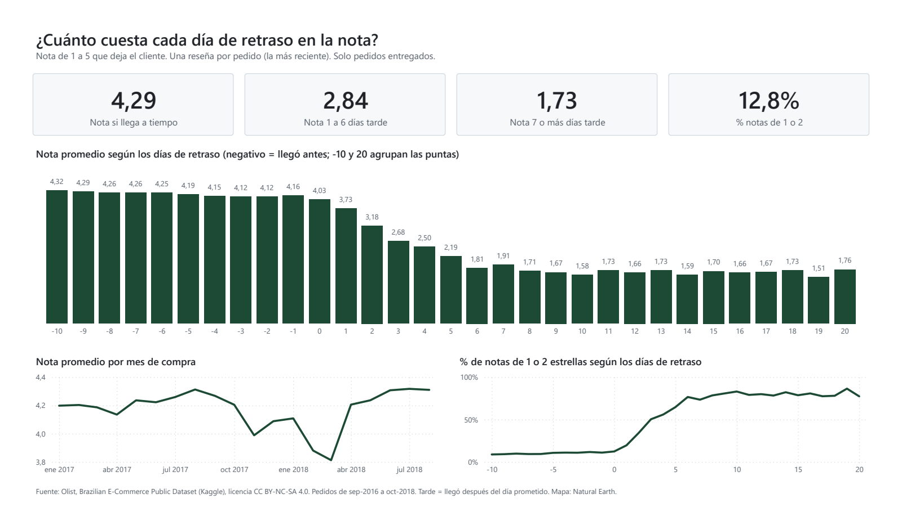
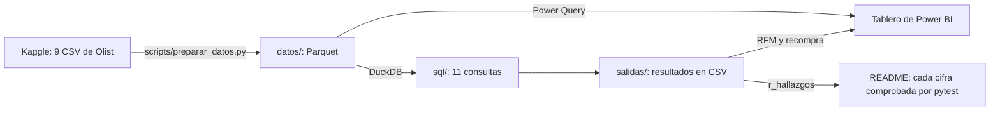

# Olist: ¿dónde se demoran las entregas?

[English version](README.en.md) · 

Analicé 99.441 pedidos reales de Olist, una tienda en línea de Brasil, para responder tres preguntas de logística: dónde se demoran las entregas, cuánto pesa el flete y qué vendedores cumplen. Lo hice con SQL (DuckDB) y un tablero de Power BI de 4 páginas.

> **En 30 segundos:** el 6,8 % de las entregas llega tarde, pero en el 77,6 % de esos casos el vendedor despachó a tiempo: el problema está en el transporte. Y llegar tarde sale caro: la nota baja de 4,29 a 1,73 en una semana de retraso. Y casi nadie vuelve a comprar: el 2,2 %.



## Qué encontré

**1. La tienda promete con mucho colchón, y aun así falla.**
En promedio promete 24,4 días y entrega en 12,5. Igual, 6.534 de los 96.470 pedidos entregados llegaron tarde: el 6,8 %. Rio de Janeiro recibe el 12,8 % de las entregas, pero se lleva el 22,9 % de los retrasos.

**2. Cuando llega tarde, casi nunca es culpa del vendedor.**
En el 77,6 % de los pedidos que llegaron tarde, el vendedor sí entregó a tiempo a la transportadora (cuento los pedidos de un solo vendedor, que son casi todos). El tiempo se pierde en el transporte: 27,9 días en los pedidos tarde contra 8,0 en los que llegan bien. Y no depende del tamaño del vendedor: chicos o grandes, llegan tarde entre el 6,4 % y el 7,3 % de las veces. Sí hay vendedores malos: el 10 % con peor tasa (de los que tienen 30 pedidos o más) llega tarde el 16,9 % de las veces, pero solo se lleva el 12,7 % de los retrasos. Arreglar a esos vendedores no resuelve el problema.

**3. La nota se cae en la primera semana y después ya no importa cuánto.**
Si llega a tiempo, la nota promedio es 4,29 de 5. Entre 1 y 6 días tarde, cada día cuesta 0,38 puntos. Desde el día 7 ya no baja más: se queda en 1,73. Y me di cuenta de por qué: el 96,2 % de esos clientes respondió la encuesta antes de que le llegara el paquete. Califican la espera, no el producto. Se nota en la primera semana: con 1 a 6 días de retraso, quien responde antes de recibir pone 1,65, y quien espera a recibirlo pone 3,73. Durante la primera semana cada día cuenta; después, la nota ya está puesta.

**4. En los pedidos baratos, el flete es casi la mitad del precio.**
En todo Olist el flete es el 16,6 % del precio de los productos. Pero en los pedidos de menos de R$50, que son el 29,8 % del total, el flete es el 48,4 %. En el 10,1 % de esos pedidos el envío cuesta más que lo que se compró. (Cuento solo pedidos entregados.)

**5. Casi nadie vuelve, y no pude probar que el retraso sea la causa.**
En todo el período, solo el 2,2 % de los clientes compró en más de un día. Al principio me salía que quien recibe tarde su primer pedido vuelve mucho menos, pero me di cuenta de que esos clientes compraron más cerca del final de los datos y tuvieron menos tiempo para volver. Midiendo a todos igual, 180 días desde que recibieron su primer pedido (lo que compraron antes de recibirlo no puede ser una reacción al retraso), volvió el 1,85 % si llegó a tiempo y el 1,37 % si llegó tarde. La prueba z da 1,82, por debajo de 1,96: hay una señal, pero no alcanza para afirmarlo al 95 %, porque son pocos clientes con entrega tarde. Lo que sí pesa es otra cosa: el 22,7 % de los clientes compró una sola vez, por un valor alto (del 40 % que más gasta), hace más de 6 meses, y no volvió. Ese grupo dejó el 41,1 % del dinero.

**Lo que yo probaría con esto:** revisar con la transportadora la ruta São Paulo → Rio de Janeiro antes que a los vendedores, avisarle al cliente apenas un pedido va a llegar tarde (la nota cae desde el primer día) y buscar cómo agrupar los envíos de menos de R$50.

## Cómo explicarlo en 2 minutos

> Quería practicar SQL con datos reales de logística, así que tomé los casi 100 mil pedidos públicos de Olist, una tienda en línea de Brasil, y me hice tres preguntas: dónde se demoran las entregas, cuánto pesa el flete y qué vendedores cumplen.
>
> Lo primero que vi es que la tienda promete casi el doble de lo que se demora: promete 24 días y entrega en 12 y medio. Aun así, uno de cada quince pedidos llega tarde, y Rio de Janeiro se lleva casi la cuarta parte de esos retrasos.
>
> Lo que más me sorprendió es que el problema no está en los vendedores. En casi ocho de cada diez pedidos tarde, el vendedor despachó a tiempo y el tiempo se perdió en la transportadora. Y los vendedores grandes y los chicos llegan tarde casi en la misma proporción.
>
> Después crucé las entregas con las reseñas. Un día de retraso ya baja la nota, y a la semana toca el piso: de 4,3 pasa a 1,7 y de ahí no baja más. Casi todos esos clientes califican antes de recibir el paquete: califican la espera. También creí que quien recibe tarde su primer pedido vuelve menos, pero cuando les di a todos el mismo tiempo para volver, la diferencia ya no alcanzaba para afirmarlo. Preferí decirlo así antes que contar algo que los datos no sostienen.
>
> Todo está en consultas SQL numeradas, con pruebas automáticas que revisan que cada cifra del README salga de los datos. El tablero de Power BI tiene cuatro páginas: logística, vendedores, clientes y reseñas.

## El tablero

| Página | Qué responde |
|---|---|
| Logística | Dónde y cuándo llegan tarde los pedidos, y en qué etapa se va el tiempo |
| Vendedores | Si el vendedor despachó a tiempo, quiénes acumulan retrasos y por qué rutas |
| Clientes | Segmentos RFM, recompra y el flete según el valor del pedido |
| Reseñas | Cuánto baja la nota con cada día de retraso |

| | |
|---|---|
|  |  |
|  | Tablero completo en PDF: [tablero.pdf](tablero.pdf) |

Las medidas DAX están en [dax/medidas.md](dax/medidas.md), para leerlas sin abrir Power BI.

## De dónde salen los datos

- **Fuente:** [Brazilian E-Commerce Public Dataset by Olist](https://www.kaggle.com/datasets/olistbr/brazilian-ecommerce), publicado por Olist en Kaggle. Son datos reales de 2016 a 2018, ya anonimizados por Olist: 9 archivos CSV con pedidos, clientes, vendedores, productos, pagos, reseñas y códigos postales.
- **Licencia:** [CC BY-NC-SA 4.0](https://creativecommons.org/licenses/by-nc-sa/4.0/). Se puede compartir y adaptar sin fines comerciales, dando crédito a Olist y con la misma licencia. Por eso la copia de `datos/` y los resultados de `salidas/` también van bajo CC BY-NC-SA 4.0, con atribución a Olist.
- **Lo que cambié:** pasé los CSV a Parquet (de 126 MB a 22 MB, mismas filas). Quité el texto de los comentarios de las reseñas, porque el análisis no lo usa y es texto escrito por personas. Y resumí la geolocalización a un punto por código postal. `scripts/preparar_datos.py` hace todo esto desde los CSV de Kaggle.
- **Mapa:** el contorno de Brasil y sus 27 estados es de [Natural Earth](https://www.naturalearthdata.com) (escala 1:50m, dominio público). `powerbi/generar_mapa_brasil.py` lo dibuja con los mismos límites de longitud y latitud que el gráfico, para que cada burbuja caiga sobre su estado.
- **Cómo cuento "tarde":** el pedido llegó después del día prometido, comparando días de calendario. Si llegó el mismo día prometido, cuenta como a tiempo. Ojo: Olist guarda la fecha prometida a las 00:00, así que si se comparan horas, todo lo que llega ese mismo día sale como tarde y el porcentaje sube a 8,1 %. Por eso otros análisis de Olist dan esa cifra.

## Cómo está armado



| Pregunta | Consulta |
|---|---|
| ¿Llega cuando se prometió? ¿En qué estados falla? | `sql/02_entrega_por_estado.sql` |
| ¿Qué vendedores cumplen? ¿Se concentran los retrasos? | `sql/03_entrega_por_vendedor.sql` |
| ¿Cuánto pesa el flete frente al precio? | `sql/04_flete.sql` |
| ¿Cuánto baja la nota con cada día de retraso? | `sql/05_demora_vs_resena.sql` |
| ¿Los clientes vuelven? ¿Influye la primera entrega? | `sql/06_cohortes_recompra.sql` |
| ¿Quiénes compran seguido y cuánto (RFM)? | `sql/07_rfm.sql` |
| ¿En qué etapa se va el tiempo? ¿Qué rutas fallan? | `sql/08_rutas_y_etapas.sql` |
| ¿Cuándo se dispararon los retrasos? | `sql/09_mes_a_mes.sql` |

## Qué hay en el repo

| Carpeta | Qué tiene |
|---|---|
| `sql/` | 11 consultas numeradas y comentadas: base limpia, calidad de datos, entregas por estado y por vendedor, flete, demora contra reseña, cohortes de recompra, RFM, rutas y etapas, mes a mes, y las cifras del README |
| `salidas/` | El resultado de cada consulta en CSV |
| `pruebas/` | Pruebas con pytest: totales de Kaggle, que las consultas cuadren entre sí, que el README cite las cifras exactas, que el tablero use campos y medidas que existen, y privacidad |
| `powerbi/` | El tablero como proyecto de texto (PBIP), el `.pbix` y el generador |
| `dax/medidas.md` | Las medidas DAX |
| `capturas/`, `tablero.pdf` | Capturas y PDF del tablero |
| `REVISION.md` | Las vueltas de revisión, con lo que encontré y arreglé |

SQL que se usa: CTE, funciones de ventana (`RANK`, `NTILE`, `LAG`, `ROW_NUMBER`, sumas acumuladas, promedio móvil), `QUALIFY`, `FILTER`, cohortes por mes de primera compra y regresión lineal con `REGR_SLOPE`.

## Cómo correrlo

Necesitas Python 3.12 y Git.

```bash
git clone https://github.com/Dsergio909/olist-logistica-sql.git
cd olist-logistica-sql
python -m venv .venv
.venv\Scripts\activate          # en Windows. En Mac o Linux: source .venv/bin/activate
pip install -r requirements.txt
python scripts/correr_sql.py     # corre las 11 consultas y escribe salidas/
python -m pytest                 # las pruebas
```

No hace falta bajar nada de Kaggle: los datos ya están en `datos/`. Si quieres rehacerlos desde los CSV originales:

```bash
pip install kagglehub
python scripts/descargar_datos.py   # baja los 9 CSV a datos_crudos/ y cuenta las filas
python scripts/preparar_datos.py    # los pasa a Parquet en datos/
```

El dataset es público y baja sin cuenta. Si Kaggle llegara a pedir credenciales, el script explica cómo crear el token (y ese archivo nunca va al repo).

**Power BI:** abre `powerbi/OlistLogistica.pbix` (trae los datos adentro). Si prefieres el proyecto de texto, abre `powerbi/OlistLogistica.pbip`, ve a Transformar datos → Parámetros, cambia `CarpetaRepo` a la carpeta donde clonaste el repo y pulsa Actualizar.

## Cómo comprobé las cifras

- **58 pruebas con pytest**, que corren solas en GitHub Actions: totales de Kaggle, que las consultas cuadren entre sí, que `salidas/` sea lo que sale del SQL, privacidad y que el README cite exactamente las cifras de `salidas/r_hallazgos.csv` (si cambio un número a mano, la prueba falla).
- **Por otro camino:** `scripts/auditoria_independiente.py` recalcula las 32 cifras del README con Python puro desde los CSV de Kaggle, sin DuckDB. Dan iguales.
- **El tablero contra el SQL:** `scripts/comparar_tablero.py` lee el PDF de Power BI y compara 88 cifras con `salidas/`. Dan iguales.
- Todo lo que revisé y arreglé está en [REVISION.md](REVISION.md).

## Qué falta

- Los datos llegan hasta agosto de 2018. Septiembre y octubre de 2018 casi no tienen pedidos, así que las series de tiempo van de enero de 2017 a agosto de 2018.
- No sé qué transportadora llevó cada pedido: Olist no lo publica. Por eso hablo de "la etapa de transporte" y no de una empresa.
- La recompra es tan baja que con estos datos no se puede saber si el retraso la afecta. Con más años de pedidos, o con datos de por qué no vuelven, se podría medir mejor.

## Sobre cómo lo hice

El código y el primer análisis los hizo Claude (IA) conmigo. Yo definí las preguntas, revisé las cifras y decidí qué contar. Las pruebas automáticas están para que nada de esto dependa de creerme.

## Licencia

- Código (SQL, Python y el generador del tablero): [MIT](LICENSE).
- Datos de `datos/` y resultados de `salidas/`: [CC BY-NC-SA 4.0](https://creativecommons.org/licenses/by-nc-sa/4.0/), atribución: Olist, *Brazilian E-Commerce Public Dataset by Olist* (Kaggle). Cada carpeta trae su propio aviso: [datos/LICENSE.md](datos/LICENSE.md) y [salidas/LICENSE.md](salidas/LICENSE.md).
